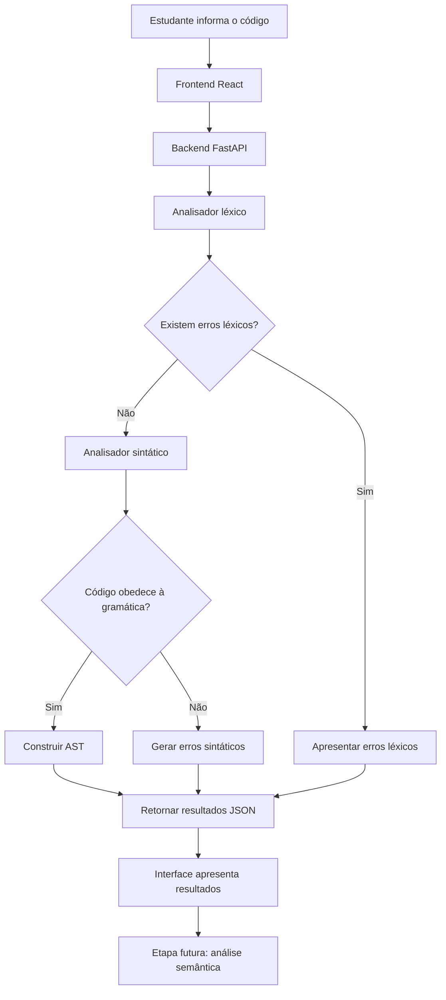

# Materiais e Métodos — Etapa 4

## 1. Objetivo

Esta etapa implementa e avalia a análise sintática do subconjunto Mini-Python no Compiler Edu Tool.

O parser recebe os tokens produzidos pelo analisador léxico, verifica as regras gramaticais e constrói uma Árvore Sintática Abstrata (AST).

A aplicação apresenta os resultados ao estudante por meio de uma interface web.

## 2. Materiais e tecnologias

| Recurso | Finalidade |
|---|---|
| Python 3.11 | Implementação do lexer e parser |
| FastAPI | Endpoints de análise |
| React 18 | Interface web |
| JavaScript | Interação e apresentação |
| CSS | Estilização |
| Pytest | Testes do backend |
| Jest | Testes do frontend |
| Docker Compose | Ambiente de execução |

O parser é implementado manualmente, sem geradores externos.

## 3. Linguagem e subconjunto

Foi adotado um subconjunto didático de Python denominado Mini-Python.

O escopo sintático contempla:

- Atribuições simples.
- Identificadores.
- Literais inteiros, reais e textuais.
- Expressões aritméticas.
- Expressões relacionais.
- Comando `print`.
- Condicionais `if/else`.
- Blocos definidos por indentação.
- Expressões entre parênteses.
- Negação numérica unária.

A gramática formal está documentada em `docs/gramatica.md`.

Construções como laços, funções, declarações tipadas e operadores lógicos estão fora do escopo atual.

## 4. Estratégia de análise sintática

Foi escolhida a estratégia descendente recursiva (Recursive Descent).

Cada função representa uma parte da gramática. O parser percorre os tokens, identifica os comandos e expressões e constrói os nós correspondentes da AST.

A estratégia foi escolhida por sua relação direta com as produções gramaticais e por facilitar a explicação do processo ao estudante.

Funções principais:

- `analisar()`
- `declaracao()`
- `atribuicao()`
- `declaracao_print()`
- `declaracao_if()`
- `bloco_indentado()`
- `expressao()`
- `soma()`
- `multiplicacao()`
- `fator()`

## 5. Fluxo de processamento

1. O estudante informa o código-fonte.
2. O frontend envia o código ao backend.
3. O scanner executa a análise léxica.
4. Se houver erros léxicos, o parser não é executado.
5. Se não houver erros léxicos, os tokens são enviados ao parser.
6. O parser verifica as regras gramaticais.
7. Se a análise sintática for bem-sucedida, a AST é construída.
8. Se houver erro sintático, o diagnóstico é retornado com localização.
9. A interface apresenta tokens, AST ou erros.

## 6. Fluxograma

A análise semântica aparece como etapa futura. Ela não é executada pelo sistema nesta versão.

## 7. Estrutura da AST

A AST é formada por nós que representam as construções sintáticas.

Tipos de nós atuais:

- Programa.
- Atribuicao.
- Print.
- Condicional.
- ExpressaoBinaria.
- ExpressaoUnaria.
- Literal.
- Identificador.

Os nós armazenam atributos específicos e posições iniciais, quando disponíveis.

O projeto não gera uma árvore de derivação separada.

## 8. Tratamento de erros

### 8.1. Erros léxicos

São produzidos pelo scanner quando um caractere, literal ou sequência não pertence ao subconjunto reconhecido.

A presença de erros léxicos impede a execução do parser.

### 8.2. Erros sintáticos

São produzidos quando os tokens não correspondem às produções da gramática.

Os diagnósticos incluem:

- Linha.
- Coluna.
- Token encontrado.
- Elemento esperado, quando identificado.
- Mensagem explicativa.

O parser utiliza sincronização por linha para tentar continuar a análise depois de determinados erros.

Essa recuperação é limitada e não garante a identificação de todos os erros de um mesmo comando.

## 9. Critérios de avaliação

Os critérios foram definidos antes da avaliação dos resultados.

| Critério | Verificação |
|---|---|
| Reconhecimento léxico | Tokens corretos para entradas válidas |
| Integração | Tokens do scanner consumidos pelo parser |
| Reconhecimento sintático | Comandos válidos aceitos |
| Rejeição sintática | Construções fora da gramática rejeitadas |
| Precedência | Multiplicação antes da adição |
| Associatividade | Operações de mesma precedência agrupadas à esquerda |
| AST | Estrutura hierárquica coerente |
| Localização | Linha e coluna dos nós e erros |
| Robustez | Entrada inválida não encerra a aplicação |
| Regressão | Funcionalidades anteriores preservadas |
| Implantação | Serviços iniciam com Docker Compose |

## 10. Casos de teste

### 10.1. Casos válidos

| Código | Resultado esperado |
|---|---|
| `x = 10` | Atribuição reconhecida |
| `preco = 3.14` | Literal real reconhecido |
| `x = 10 + 5` | Soma reconhecida |
| `x = 10 + 5 * 2` | Precedência respeitada |
| `nome = "Maria"` | Literal textual reconhecido |
| `print(x)` | Comando de saída reconhecido |
| `if x > 0:` com bloco indentado | Condicional reconhecido |
| `if/else` com blocos válidos | Condicional completo reconhecido |

### 10.2. Casos inválidos

| Código | Resultado esperado |
|---|---|
| `x = 10 +` | Expressão incompleta |
| `print((10 + 5)` | Parêntese não fechado |
| `x =` | Expressão ausente |
| `while x:` | Comando fora do escopo |
| `else:` isolado | Comando não reconhecido |

### 10.3. Casos de integração

- Código com erro léxico.
- Código com erro sintático.
- Programa com várias atribuições.
- Condicional com `else`.
- Condicionais aninhados.
- Programa com comentários e linhas vazias.
- Operações encadeadas.

## 11. Trabalhos relacionados

### 11.1. VAST — Visualization of Syntax Trees

Almeida-Martínez, Urquiza-Fuentes e Velázquez-Iturbide apresentam o VAST, ferramenta educacional voltada ao ensino de compiladores e processamento de linguagens.

O trabalho descreve a geração e visualização de árvores sintáticas e do processo de construção dessas árvores. Também destaca a possibilidade de visualizar o comportamento de parsers desenvolvidos pelos estudantes e o tratamento de árvores de grande dimensão.

Relação com o Compiler Edu Tool:

- Ambos utilizam árvores para representar estruturas sintáticas.
- Ambos possuem finalidade educacional.
- O Compiler Edu Tool utiliza uma AST produzida por um parser descendente recursivo próprio.
- O VAST é apresentado como ferramenta de visualização do comportamento de parsers, enquanto este projeto integra scanner, parser, API e interface web.

Referência:

ALMEIDA-MARTÍNEZ, Francisco J.; URQUIZA-FUENTES, Jaime; VELÁZQUEZ-ITURBIDE, J. Ángel. Visualization of Syntax Trees for Language Processing Courses. Journal of Universal Computer Science, v. 15, n. 7, p. 1546–1561, 2009.

DOI: https://doi.org/10.3217/jucs-015-07-1546

### 11.2. JFLAP

JFLAP é um conjunto de ferramentas educacionais para linguagens formais e teoria dos autômatos.

Entre seus recursos estão gramáticas livres de contexto e experimentação com métodos de parsing, incluindo construção de tabelas LL e SLR.

O trabalho de Cavalcante, Finley e Rodger descreve a utilização do JFLAP em atividades de ensino de linguagens formais, incluindo algoritmos de parsing.

Relação com o Compiler Edu Tool:

- Ambos permitem trabalhar com gramáticas e parsing.
- JFLAP possui foco amplo em linguagens formais, autômatos e métodos de análise.
- O Compiler Edu Tool concentra-se no fluxo de análise léxica e sintática de um subconjunto de linguagem de programação.
- O projeto utiliza um parser descendente recursivo próprio, enquanto JFLAP oferece recursos para experimentar diferentes métodos de parsing.

Referências:

CAVALCANTE, Ryan; FINLEY, Thomas; RODGER, Susan H. A Visual and Interactive Automata Theory Course with JFLAP 4.0. ACM SIGCSE Bulletin, v. 36, n. 1, 2004.

DOI: https://doi.org/10.1145/1028174.971349

JFLAP. What Is JFLAP? Disponível em: https://jflap.org/whatis.html

### 11.3. LISA — Syntax Directed Translation Visualization

Nicolalde-Rodríguez e Urquiza-Fuentes estudam o uso de visualização de tradução dirigida pela sintaxe no ensino de compiladores.

O estudo preliminar envolveu 34 estudantes e comparou a experiência com LISA e CUP.

Os autores relatam que LISA foi avaliada como mais motivadora e fácil de usar, além de apresentar melhor identificação de conceitos teóricos pelos estudantes.

Na comparação entre aulas tradicionais e aulas com visualização, o grupo que utilizou a ferramenta obteve desempenho superior no teste de conhecimento apresentado no estudo.

Relação com o Compiler Edu Tool:

- O estudo reforça a importância da visualização no ensino de conceitos de compiladores.
- LISA oferece recursos de visualização do processo de construção e avaliação de árvores de tradução.
- O Compiler Edu Tool apresenta tokens, AST e diagnósticos de um subconjunto próprio.
- Os resultados do estudo com LISA não podem ser atribuídos ao Compiler Edu Tool. Uma avaliação com estudantes seria necessária.

Referência:

NICOLALDE-RODRÍGUEZ, Damián; URQUIZA-FUENTES, Jaime. Educational Impact of Syntax Directed Translation Visualization, a Preliminary Study. In: IEEE Symposium on Visual Languages and Human-Centric Computing, 2018.

## 12. Análise comparativa

Legenda:

- ✓ Recurso descrito na fonte ou implementado no projeto.
- ✗ Recurso explicitamente ausente na fonte ou no projeto.
- NI Informação não identificada na fonte consultada.
- N/A Não aplicável.

| Característica | Compiler Edu Tool | VAST | JFLAP | LISA |
|---|---|---|---|---|
| Finalidade educacional | ✓ | ✓ | ✓ | ✓ |
| Gramáticas formais | ✓ | NI | ✓ | ✓ |
| Análise sintática | ✓ | ✓ | ✓ | ✓ |
| Visualização de árvores | ✓ | ✓ | NI | ✓ |
| Construção de árvores | ✓ | ✓ | NI | ✓ |
| Visualização de parser desenvolvido pelo estudante | NI | ✓ | NI | NI |
| Scanner integrado no mesmo projeto | ✓ | NI | NI | NI |
| Interface web React | ✓ | NI | NI | NI |
| API FastAPI | ✓ | NI | NI | NI |
| Erros sintáticos com localização | ✓ | NI | NI | NI |
| Parser descendente recursivo próprio | ✓ | NI | NI | NI |

A tabela não interpreta a ausência de descrição como prova de inexistência. `NI` indica somente que a característica não foi identificada nas fontes consultadas.

## 13. Discussão

Os trabalhos consultados indicam que visualizações podem auxiliar a apresentação de conceitos relacionados a parsing e árvores sintáticas.

O VAST concentra-se na visualização de árvores e do processo de construção. O JFLAP oferece recursos para experimentação com gramáticas e algoritmos de parsing. O estudo de LISA investiga a utilização de visualização no ensino de tradução dirigida pela sintaxe.

O Compiler Edu Tool adota uma arquitetura integrada, com scanner, parser, AST, API e interface web.

Essa integração constitui uma característica de implementação do projeto, mas não permite afirmar superioridade em relação às ferramentas estudadas.

A avaliação educacional da interface depende de testes com estudantes e coleta de evidências de uso.

## 14. Limitações metodológicas

A comparação foi realizada a partir das descrições e publicações consultadas, e não de uma avaliação experimental equivalente de todas as ferramentas.

Não foram realizados testes controlados com estudantes para medir aprendizagem, motivação ou redução de erros.

Os resultados dos testes automatizados verificam propriedades técnicas do software, mas não demonstram, isoladamente, melhoria de aprendizagem.

## 15. Relação com a Etapa 5

A AST construída nesta etapa será utilizada como base para a análise semântica.

Na próxima etapa, poderão ser acrescentadas verificações de declaração de identificadores, compatibilidade de tipos e outras regras de significado.

Essas verificações não fazem parte dos resultados da Etapa 4.
